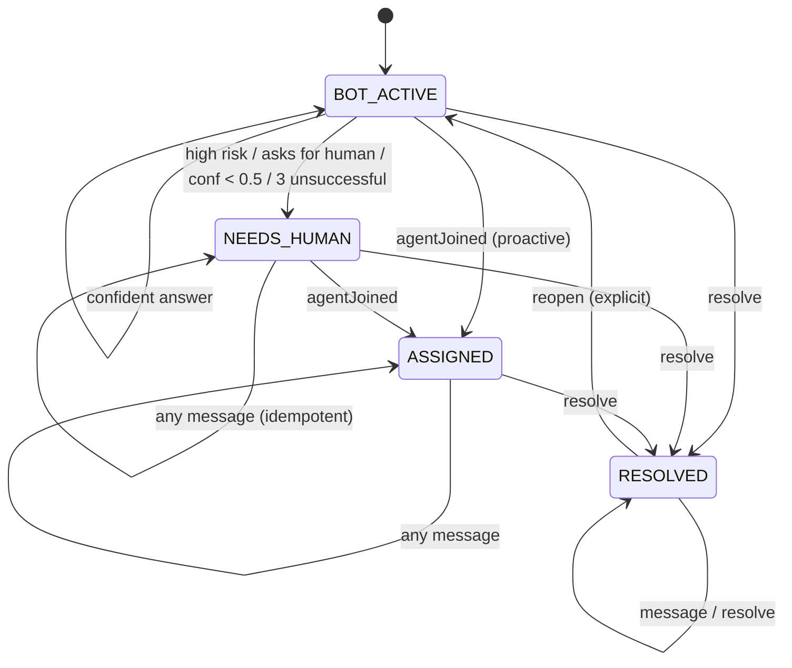

# Problem 4 – Human escalation engine

> **Priority: MEDIUM (predicted).** Fin answers customers; when should a human take over?
> The interviewer wants a clean **state machine**, explicit rules and idempotency.

| File | Purpose |
|------|---------|
| [`practice/Practice.kt`](practice/Practice.kt) | Skeleton + runnable examples. |
| [`solution/Solution.kt`](solution/Solution.kt) | Reference state machine with reasons + audit trail. |
| `src/test/kotlin/intercom/_4escalationengine/` | Unit tests. |

```bash
./gradlew -q runMain -PmainClass=intercom._4escalationengine.practice.PracticeKt
./gradlew -q runMain -PmainClass=intercom._4escalationengine.solution.SolutionKt
```

---

## 1. Prompt

> Fin handles conversations until it can't. Build the engine that decides when to hand over to a human.

```kotlin
enum class ConversationStatus { BOT_ACTIVE, NEEDS_HUMAN, ASSIGNED, RESOLVED }

class EscalationEngine {
    fun processMessage(conversationId: String, message: String, confidence: Double, isHighRisk: Boolean): ConversationStatus
    fun agentJoined(conversationId: String, agentId: String): ConversationStatus
    fun resolve(conversationId: String): ConversationStatus
}
```

Rules:
1. **High risk** (fraud, legal, account takeover…) → escalate immediately.
2. **Confidence < 0.5** → escalate.
3. **3 unsuccessful attempts** → escalate. *(Solution: 0.5 ≤ confidence < 0.7, consecutive; a confident answer resets.)*
4. A **resolved** conversation is **not** auto-reopened.
5. Escalation is **idempotent** – never escalate (page a human) twice.

### Example

```text
processMessage(c1, "How do I reset my password?", 0.95, false)       -> BOT_ACTIVE
processMessage(c1, "It still says my account is locked", 0.35, false) -> NEEDS_HUMAN
agentJoined(c1, "alice")                                              -> ASSIGNED

processMessage(c3, ..., 0.60) -> BOT_ACTIVE
processMessage(c3, ..., 0.65) -> BOT_ACTIVE
processMessage(c3, ..., 0.55) -> NEEDS_HUMAN   (3 unsuccessful)

resolve(c6) -> RESOLVED; processMessage(c6, "thanks!", 0.2, false) -> RESOLVED
```

### State machine



---

## 2. Suggested timeline (50 min)

| Time | Phase |
|------|-------|
| 0–7 | Clarify rules (what's "unsuccessful"? consecutive?). Draw the state diagram **before** coding. |
| 7–25 | Implement `processMessage` with rule precedence; `agentJoined`; `resolve`. |
| 25–32 | Run examples; test idempotency and resolved behaviour. |
| 32–50 | Follow-ups: reasons/audit, configurable thresholds, re-open, SLA timers, concurrency. |

---

## 3. Clarifying questions

1. What counts as an **unsuccessful attempt**? Consecutive or total? Does a good answer reset it?
2. Rule precedence when several apply (high risk + low confidence)? *(Record the most severe reason.)*
3. What happens to messages once escalated / assigned – does the bot keep answering?
4. Can an agent join proactively while the bot is still active? *(Yes.)*
5. Agent joins a resolved conversation? *(Error – reopen first.)*
6. Customer replies after resolution – reopen? *(Not automatically, per rules.)*
7. Unknown conversation ids? Validation of confidence range?
8. Should we emit events (notify the inbox / assignment system) on escalation?

---

## 4. Progressive hints

1. Per conversation: `status`, `unsuccessfulStreak`, `assignee`.
2. Start `processMessage` with: *"if status != BOT_ACTIVE return status"*. That one line gives idempotency and "resolved stays resolved".
3. Evaluate rules in priority order with a `when` that returns a **reason** (or null) – easy to test and log.
4. Emit an `Escalation(conversationId, reason)` exactly once at the transition – this is what would page a human / call the assignment system (Problem 1).
5. Keep illegal transitions explicit (`check(...)` → `IllegalStateException`).

---

## 5. Complexity

O(1) per operation (plus O(len) for the "asks for a human" regex). Space O(c) conversations.

---

## 6. Follow-ups

| Follow-up | Strong answer |
|-----------|---------------|
| Why a state machine? | Makes legal transitions explicit; easy to reason about, test, persist (`status` column) and audit. Alternative: sealed classes with transition functions. |
| Configurable thresholds per workspace | Constructor params / per-workspace config; A/B test thresholds. |
| Escalation reasons & analytics | Store the reason; dashboards for "why does Fin hand over?" – feeds back into content (Problem 6). |
| Wire up to assignment (Problem 1) | On `→ NEEDS_HUMAN` publish an event; the assignment system assigns, then calls `agentJoined`. |
| SLA: nobody picks it up in 5 min | Timer/scheduler escalates priority or routes to another team. |
| Reopen semantics | Explicit `reopen`, or auto-reopen to `ASSIGNED` with the previous assignee if within N days. |
| Agent hands back to Fin | `ASSIGNED → BOT_ACTIVE` transition, reset the streak. |
| Concurrency / duplicates | Optimistic locking on a `version` column; compare-and-set `status` so two workers can't both escalate. Message ids for dedupe. |
| Testing | Table-driven tests of (state, event) → state; property: never two escalations without an intervening resolve/reopen. |

---

## 7. Self-review checklist

- [ ] Example sequence matches.
- [ ] Rule precedence explicit; high risk wins even at confidence 0.99.
- [ ] Second risky message doesn't create a second escalation.
- [ ] Resolved stays resolved; agent can't join a resolved conversation.
