# Graph Data Structures and Algorithms in Kotlin

> Interview revision notes covering graph fundamentals, components, graph types, representations, traversal techniques, complexity, common questions, and real-life applications.

---

## 1. Introduction to Graphs

A **graph** is a non-linear data structure used to represent relationships between objects.

A graph is commonly written as:

`G = (V, E)`

Where:

- `G` means the complete graph.
- `V` is the set of **vertices** or **nodes**.
- `E` is the set of **edges** connecting pairs of vertices.

In plain English: **a graph is made of a collection of vertices and a collection of edges connecting them**.

For example:

```text
V = {A, B, C, D}
E = {(A, B), (A, C), (B, D), (C, D)}
```

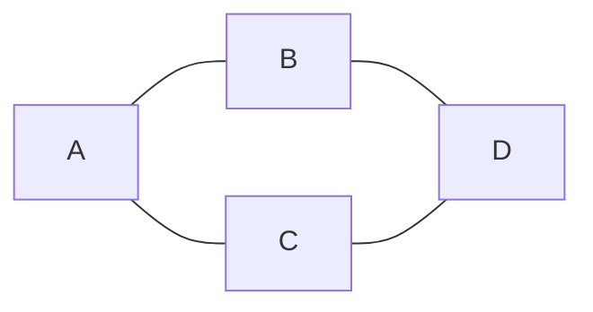

Graphs can model road networks, social networks, computer networks, dependencies, recommendations, web pages, and many other connected systems.

### Key graph terminology

| Term | Meaning |
|---|---|
| Vertex/node | An individual object in the graph |
| Edge | A relationship or connection between two vertices |
| Adjacent vertices | Vertices connected directly by an edge |
| Degree | Number of edges connected to a vertex |
| In-degree | Number of directed edges entering a vertex |
| Out-degree | Number of directed edges leaving a vertex |
| Path | A sequence of vertices connected by edges |
| Path length | Number of edges in an unweighted path |
| Cycle | A path that starts and ends at the same vertex |
| Connected graph | Every pair of vertices has a path between them |
| Connected component | A maximal connected portion of a graph |
| Strongly connected | Every vertex in a directed graph can reach every other vertex |
| Weakly connected | A directed graph becomes connected when edge directions are ignored |
| Self-loop | An edge from a vertex to itself |
| Parallel edges | Multiple edges connecting the same pair of vertices |

---

## 2. Components of a Graph Data Structure

### 2.1 Vertices

Vertices represent the entities being modeled.

Examples:

- Users in a social network
- Cities in a road network
- Tasks in a dependency graph
- Web pages on the internet

### 2.2 Edges

Edges represent relationships between vertices.

An edge can be:

- Directed or undirected
- Weighted or unweighted
- Unique or one of several parallel edges

### 2.3 Weights

A weight is a value associated with an edge.

It may represent:

- Distance
- Cost
- Time
- Capacity
- Risk
- Similarity

### 2.4 Paths

A path is a sequence of connected vertices.

For example:

```text
A -> B -> D
```

In an unweighted graph, its length is the number of edges. In a weighted graph, its total cost is normally the sum of its edge weights.

### 2.5 Cycles

A cycle starts and ends at the same vertex without repeating an edge. Depending on the definition being used, intermediate vertices may also be required to be distinct.

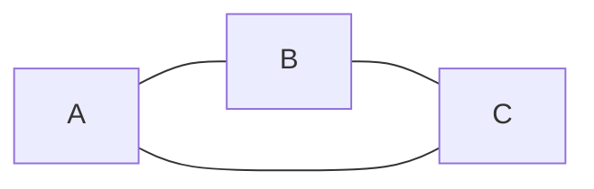

### 2.6 Connected components

An undirected graph may contain separate groups of connected vertices.

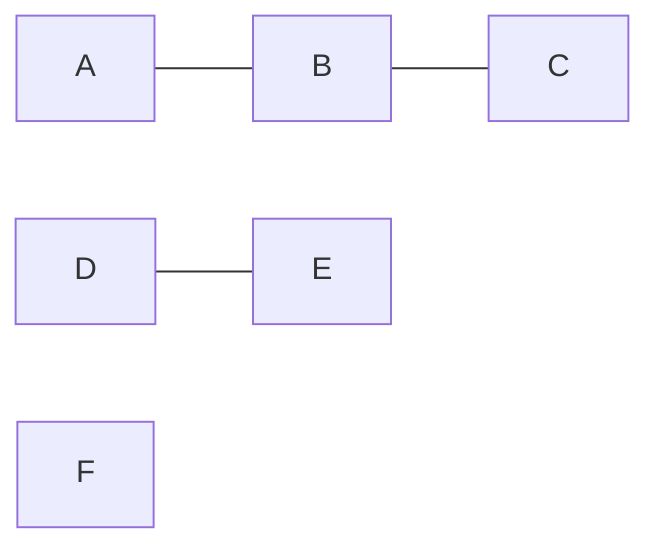

The graph above has three connected components:

1. `{A, B, C}`
2. `{D, E}`
3. `{F}`

---

## 3. Types of Graphs

Graphs can be classified using several independent properties.

## 3.1 Based on edge direction

### Undirected graph

An undirected edge has no direction.

```text
A -- B
```

If `A` is connected to `B`, then `B` is also connected to `A`.

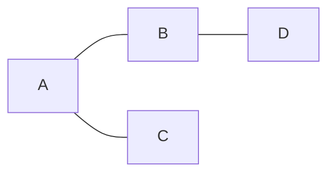

Common examples:

- Facebook friendships
- Two-way roads
- Physical network connections

### Directed graph

A directed graph, or **digraph**, contains edges with direction.

```text
A -> B
```

This does not automatically imply that `B -> A`.

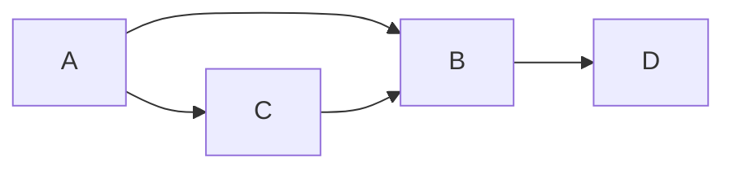

Common examples:

- Instagram follows
- Web page hyperlinks
- Task dependencies
- One-way roads

### Mixed graph

A mixed graph can contain both directed and undirected edges. It is less common in basic interview questions but useful in some real-world models.

---

## 3.2 Based on edge weights

### Unweighted graph

All edges are treated equally. The shortest path minimizes the number of edges.

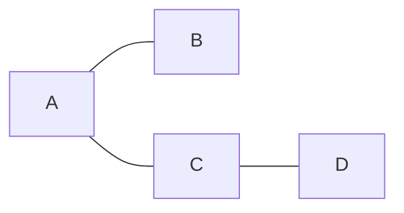

Use **Breadth-First Search** to find shortest paths in an unweighted graph.

### Weighted graph

Each edge has a cost or weight.

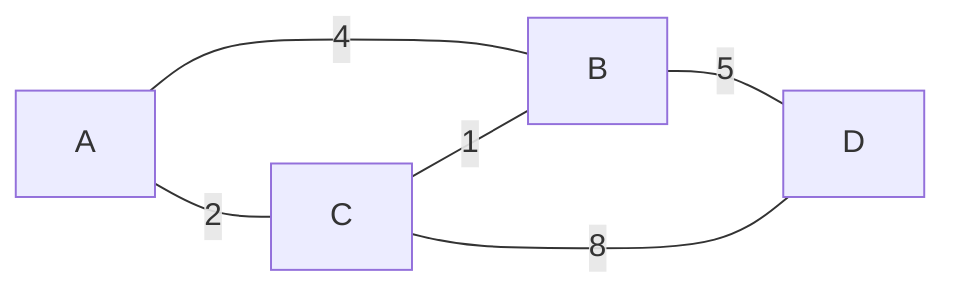

Depending on the constraints:

- **Dijkstra's algorithm**: shortest paths with non-negative weights
- **Bellman-Ford algorithm**: shortest paths when negative edges may exist
- **Floyd-Warshall algorithm**: shortest paths between every pair of vertices
- **Prim's or Kruskal's algorithm**: minimum spanning tree

### Positively weighted graph

All edge weights are greater than zero.

### Negatively weighted graph

At least one edge has a negative weight. A negative edge does not necessarily mean that the graph has a negative cycle.

### Negative cycle

A negative cycle is a cycle whose total weight is less than zero. If such a cycle is reachable on a route to the destination, a finite shortest path may not exist because the cycle can be repeated to reduce the cost indefinitely.

---

## 3.3 Other important graph classifications

### Simple graph

A simple graph has:

- No self-loops
- No parallel edges

### Multigraph

A multigraph permits multiple edges between the same pair of vertices.

### Pseudograph

A pseudograph permits self-loops and may also permit parallel edges.

### Connected graph

In an undirected connected graph, every vertex can reach every other vertex.

### Disconnected graph

At least one pair of vertices has no path between them.

### Complete graph

Every pair of distinct vertices is connected by an edge.

For an undirected simple complete graph with `V` vertices:

`E = V × (V - 1) / 2`

For a directed simple graph with both directions allowed and no self-loops:

`E = V × (V - 1)`

### Cyclic graph

The graph contains at least one cycle.

### Acyclic graph

The graph contains no cycles.

### Directed Acyclic Graph

A **DAG** is a directed graph with no directed cycles.

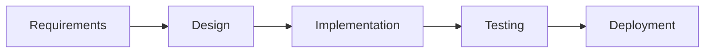

DAGs are used for:

- Task scheduling
- Build systems
- Course prerequisites
- Data-processing pipelines
- Version history

### Bipartite graph

The vertices can be split into two disjoint sets so that every edge connects a vertex in one set to a vertex in the other set.

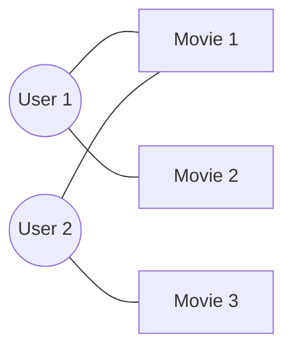

A graph is bipartite if and only if it contains no odd-length cycle.

Common uses:

- User-to-product recommendations
- Job-to-applicant matching
- Student-to-course enrollment

### Sparse graph

A sparse graph has relatively few edges compared with the maximum possible number of edges.

An adjacency list is normally a good representation.

### Dense graph

A dense graph has a number of edges close to the maximum possible.

An adjacency matrix may be appropriate.

---

## 4. Graph Representations in Kotlin

The three common graph representations are:

1. Adjacency list
2. Adjacency matrix
3. Edge list

The best representation depends on the operations required and whether the graph is sparse or dense.

## 4.1 Adjacency list

Each vertex stores a collection of its neighboring vertices.

Example:

```text
0 -> [1, 2]
1 -> [0, 3]
2 -> [0, 3]
3 -> [1, 2]
```

### Unweighted graph implementation

```kotlin
class Graph(
    private val vertexCount: Int,
    private val directed: Boolean = false
) {
    private val adjacencyList: Array<MutableList<Int>> =
        Array(vertexCount) { mutableListOf() }

    fun addEdge(source: Int, destination: Int) {
        require(source in 0 until vertexCount)
        require(destination in 0 until vertexCount)

        adjacencyList[source].add(destination)

        if (!directed) {
            adjacencyList[destination].add(source)
        }
    }

    fun neighbors(vertex: Int): List<Int> {
        require(vertex in 0 until vertexCount)
        return adjacencyList[vertex]
    }

    fun printGraph() {
        adjacencyList.forEachIndexed { vertex, neighbors ->
            println("$vertex -> ${neighbors.joinToString()}")
        }
    }
}

fun main() {
    val graph = Graph(vertexCount = 5)

    graph.addEdge(0, 1)
    graph.addEdge(0, 2)
    graph.addEdge(1, 3)
    graph.addEdge(2, 3)
    graph.addEdge(3, 4)

    graph.printGraph()
}
```

### Complexity

| Operation | Complexity |
|---|---:|
| Storage | `O(V + E)` |
| Add edge | Usually `O(1)` |
| Iterate over neighbors | `O(degree(v))` |
| Check whether `(u, v)` exists | `O(degree(u))` with a list |
| Remove edge | `O(degree(u))` |

Using a `MutableSet<Int>` instead of `MutableList<Int>` can provide average `O(1)` edge lookup and prevent duplicate neighbors, but it has additional memory overhead.

---

## 4.2 Weighted adjacency list

```kotlin
data class WeightedEdge(
    val destination: Int,
    val weight: Int
)

class WeightedGraph(
    private val vertexCount: Int,
    private val directed: Boolean = false
) {
    private val adjacencyList: Array<MutableList<WeightedEdge>> =
        Array(vertexCount) { mutableListOf() }

    fun addEdge(source: Int, destination: Int, weight: Int) {
        require(source in 0 until vertexCount)
        require(destination in 0 until vertexCount)

        adjacencyList[source].add(WeightedEdge(destination, weight))

        if (!directed) {
            adjacencyList[destination].add(WeightedEdge(source, weight))
        }
    }

    fun neighbors(vertex: Int): List<WeightedEdge> {
        require(vertex in 0 until vertexCount)
        return adjacencyList[vertex]
    }
}
```

---

## 4.3 Generic adjacency list

Use a generic graph when vertices are represented by values such as city names or user IDs rather than consecutive integers.

```kotlin
class GenericGraph<T>(
    private val directed: Boolean = false
) {
    private val adjacencyList = mutableMapOf<T, MutableSet<T>>()

    fun addVertex(vertex: T) {
        adjacencyList.putIfAbsent(vertex, mutableSetOf())
    }

    fun addEdge(source: T, destination: T) {
        addVertex(source)
        addVertex(destination)

        adjacencyList.getValue(source).add(destination)

        if (!directed) {
            adjacencyList.getValue(destination).add(source)
        }
    }

    fun neighbors(vertex: T): Set<T> =
        adjacencyList[vertex]?.toSet() ?: emptySet()

    fun vertices(): Set<T> = adjacencyList.keys
}

fun main() {
    val graph = GenericGraph<String>()

    graph.addEdge("Nairobi", "Mombasa")
    graph.addEdge("Nairobi", "Nakuru")
    graph.addEdge("Nakuru", "Kisumu")

    println(graph.neighbors("Nairobi"))
}
```

---

## 4.4 Adjacency matrix

An adjacency matrix is a two-dimensional array in which:

```text
matrix[u][v] = 1
```

means an edge exists from `u` to `v`.

```kotlin
class MatrixGraph(
    private val vertexCount: Int,
    private val directed: Boolean = false
) {
    private val matrix: Array<IntArray> =
        Array(vertexCount) { IntArray(vertexCount) }

    fun addEdge(source: Int, destination: Int) {
        require(source in 0 until vertexCount)
        require(destination in 0 until vertexCount)

        matrix[source][destination] = 1

        if (!directed) {
            matrix[destination][source] = 1
        }
    }

    fun removeEdge(source: Int, destination: Int) {
        matrix[source][destination] = 0

        if (!directed) {
            matrix[destination][source] = 0
        }
    }

    fun hasEdge(source: Int, destination: Int): Boolean =
        matrix[source][destination] == 1

    fun neighbors(vertex: Int): List<Int> =
        matrix[vertex].indices.filter { neighbor ->
            matrix[vertex][neighbor] != 0
        }
}
```

### Weighted adjacency matrix

For a weighted graph, each cell can store the edge weight. A separate sentinel value must indicate that no edge exists.

```kotlin
class WeightedMatrixGraph(
    private val vertexCount: Int,
    private val noEdge: Int = Int.MAX_VALUE
) {
    private val matrix: Array<IntArray> =
        Array(vertexCount) { IntArray(vertexCount) { noEdge } }

    init {
        for (vertex in 0 until vertexCount) {
            matrix[vertex][vertex] = 0
        }
    }

    fun addDirectedEdge(source: Int, destination: Int, weight: Int) {
        matrix[source][destination] = weight
    }

    fun weight(source: Int, destination: Int): Int? =
        matrix[source][destination]
            .takeUnless { it == noEdge }
}
```

Do not use `0` to mean "no edge" if zero-weight edges are valid.

### Complexity

| Operation | Complexity |
|---|---:|
| Storage | `O(V²)` |
| Add edge | `O(1)` |
| Remove edge | `O(1)` |
| Check whether an edge exists | `O(1)` |
| Iterate over neighbors | `O(V)` |

---

## 4.5 Edge list

An edge list stores all graph edges directly.

```kotlin
data class Edge(
    val source: Int,
    val destination: Int,
    val weight: Int = 1
)

class EdgeListGraph {
    private val edges = mutableListOf<Edge>()

    fun addEdge(source: Int, destination: Int, weight: Int = 1) {
        edges.add(Edge(source, destination, weight))
    }

    fun allEdges(): List<Edge> = edges.toList()
}
```

### Complexity

| Operation | Complexity |
|---|---:|
| Storage | `O(E)` |
| Add edge | Usually `O(1)` |
| Find a specific edge | `O(E)` |
| Find all neighbors of a vertex | `O(E)` |

Edge lists are especially useful for algorithms such as:

- Kruskal's minimum spanning tree algorithm
- Bellman-Ford shortest path algorithm
- Importing and exporting graph data

---

## 4.6 Representation comparison

| Feature | Adjacency list | Adjacency matrix | Edge list |
|---|---:|---:|---:|
| Space | `O(V + E)` | `O(V²)` | `O(E)` |
| Add edge | Usually `O(1)` | `O(1)` | Usually `O(1)` |
| Check edge | `O(degree(u))` | `O(1)` | `O(E)` |
| Iterate over neighbors | `O(degree(u))` | `O(V)` | `O(E)` |
| Best for | Sparse graphs and traversal | Dense graphs and fast edge checks | Edge-oriented algorithms |

### Interview rule of thumb

- Choose an **adjacency list** by default.
- Choose an **adjacency matrix** when the graph is dense or constant-time edge lookup is essential.
- Choose an **edge list** when an algorithm processes edges as the primary unit.

---

## 5. Difference Between a Graph and a Tree

A tree is a restricted type of graph.

| Property | Graph | Tree |
|---|---|---|
| General definition | Vertices connected by edges | Connected, acyclic, undirected graph |
| Cycles | May contain cycles | Cannot contain cycles |
| Connectivity | May be disconnected | Must be connected |
| Number of edges | Varies | Exactly `V - 1` for `V` vertices |
| Path between two vertices | Zero, one, or multiple simple paths | Exactly one simple path |
| Root | Not required | Often rooted for traversal or hierarchy |
| Parent-child relationship | Not inherent | Present in a rooted tree |
| Self-loops | May be allowed | Not allowed |
| Direction | May be directed or undirected | Usually conceptually hierarchical when rooted |

### Important tree facts

For an undirected graph with `V` vertices, any two of the following imply the third:

1. The graph is connected.
2. The graph is acyclic.
3. The graph has exactly `V - 1` edges.

### Graph example

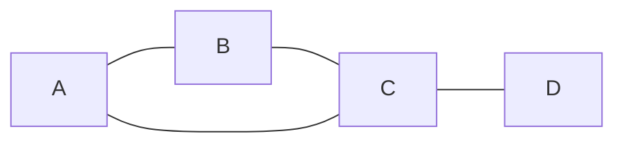

The example is not a tree because it contains a cycle.

### Tree example

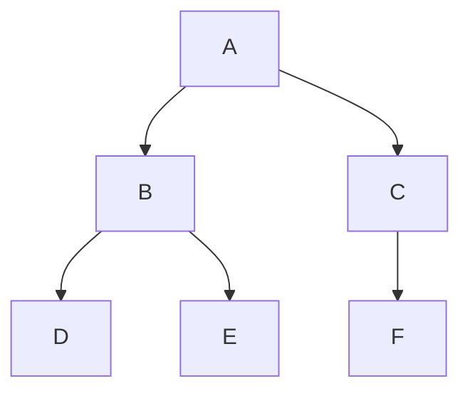

Ignoring the arrows used to show the parent-child hierarchy, the structure is connected and acyclic.

---

## 6. Graph Traversal Techniques

The two fundamental graph traversal algorithms are:

1. Breadth-First Search
2. Depth-First Search

Both have the following complexity when an adjacency list is used:

`O(V + E)`

The `V` term comes from visiting vertices, and the `E` term comes from examining edges.

## 6.1 Breadth-First Search

BFS explores vertices level by level. It uses a **queue**.

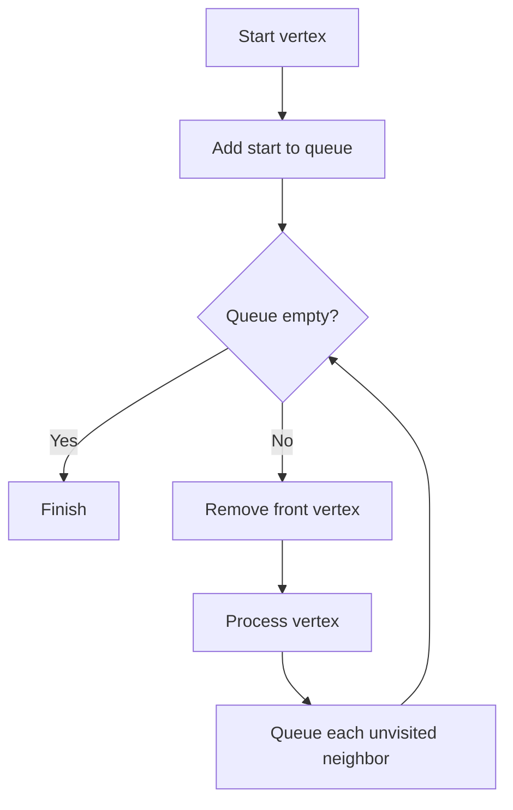

### BFS implementation in Kotlin

```kotlin
import java.util.ArrayDeque

fun bfs(
    graph: Array<List<Int>>,
    start: Int
): List<Int> {
    val visited = BooleanArray(graph.size)
    val queue = ArrayDeque<Int>()
    val traversalOrder = mutableListOf<Int>()

    visited[start] = true
    queue.addLast(start)

    while (queue.isNotEmpty()) {
        val vertex = queue.removeFirst()
        traversalOrder.add(vertex)

        for (neighbor in graph[vertex]) {
            if (!visited[neighbor]) {
                visited[neighbor] = true
                queue.addLast(neighbor)
            }
        }
    }

    return traversalOrder
}
```

Mark a vertex as visited **when it is added to the queue**, not when it is removed. This prevents the same vertex from being queued repeatedly.

### BFS shortest distances in an unweighted graph

```kotlin
import java.util.ArrayDeque

fun shortestDistances(
    graph: Array<List<Int>>,
    start: Int
): IntArray {
    val distance = IntArray(graph.size) { -1 }
    val queue = ArrayDeque<Int>()

    distance[start] = 0
    queue.addLast(start)

    while (queue.isNotEmpty()) {
        val vertex = queue.removeFirst()

        for (neighbor in graph[vertex]) {
            if (distance[neighbor] == -1) {
                distance[neighbor] = distance[vertex] + 1
                queue.addLast(neighbor)
            }
        }
    }

    return distance
}
```

Here, `-1` means that a vertex is unreachable from the starting vertex.

### Reconstructing the shortest path

```kotlin
import java.util.ArrayDeque

fun shortestPath(
    graph: Array<List<Int>>,
    start: Int,
    destination: Int
): List<Int> {
    val parent = IntArray(graph.size) { -1 }
    val visited = BooleanArray(graph.size)
    val queue = ArrayDeque<Int>()

    visited[start] = true
    queue.addLast(start)

    while (queue.isNotEmpty()) {
        val vertex = queue.removeFirst()

        if (vertex == destination) {
            break
        }

        for (neighbor in graph[vertex]) {
            if (!visited[neighbor]) {
                visited[neighbor] = true
                parent[neighbor] = vertex
                queue.addLast(neighbor)
            }
        }
    }

    if (!visited[destination]) {
        return emptyList()
    }

    val path = mutableListOf<Int>()
    var current = destination

    while (current != -1) {
        path.add(current)
        current = parent[current]
    }

    path.reverse()
    return path
}
```

### Common BFS applications

- Shortest path in an unweighted graph
- Level-order traversal of a tree
- Finding connected components
- Checking whether a graph is bipartite
- Finding nodes within `K` edges
- Web crawling
- Broadcasting in a network

---

## 6.2 Depth-First Search

DFS explores one path as deeply as possible before backtracking. It uses recursion or an explicit stack.

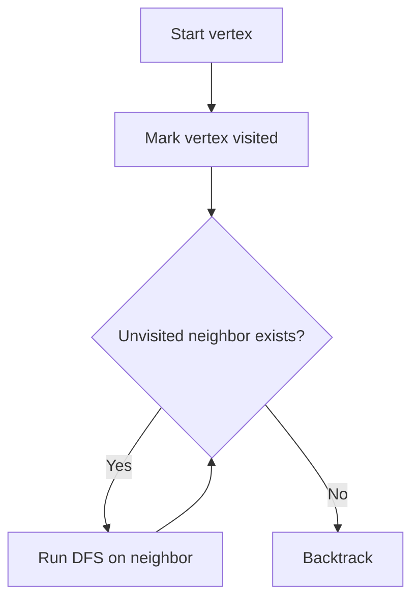

### Recursive DFS in Kotlin

```kotlin
fun dfsRecursive(
    graph: Array<List<Int>>,
    start: Int
): List<Int> {
    val visited = BooleanArray(graph.size)
    val traversalOrder = mutableListOf<Int>()

    fun dfs(vertex: Int) {
        visited[vertex] = true
        traversalOrder.add(vertex)

        for (neighbor in graph[vertex]) {
            if (!visited[neighbor]) {
                dfs(neighbor)
            }
        }
    }

    dfs(start)
    return traversalOrder
}
```

### Iterative DFS in Kotlin

```kotlin
import java.util.ArrayDeque

fun dfsIterative(
    graph: Array<List<Int>>,
    start: Int
): List<Int> {
    val visited = BooleanArray(graph.size)
    val stack = ArrayDeque<Int>()
    val traversalOrder = mutableListOf<Int>()

    stack.addLast(start)

    while (stack.isNotEmpty()) {
        val vertex = stack.removeLast()

        if (visited[vertex]) {
            continue
        }

        visited[vertex] = true
        traversalOrder.add(vertex)

        for (index in graph[vertex].indices.reversed()) {
            val neighbor = graph[vertex][index]
            if (!visited[neighbor]) {
                stack.addLast(neighbor)
            }
        }
    }

    return traversalOrder
}
```

Neighbors are pushed in reverse order only when a specific traversal order is desired. DFS order is otherwise dependent on adjacency ordering.

### Common DFS applications

- Cycle detection
- Topological sorting
- Connected components
- Strongly connected components
- Maze solving
- Path existence
- Backtracking problems
- Bridges and articulation points

### Recursion warning

Recursive DFS is concise, but a very deep graph may cause a stack overflow. Use iterative DFS when the graph depth can be large.

---

## 6.3 Traversing disconnected graphs

Calling BFS or DFS once only visits the connected component containing the start vertex.

To traverse an entire disconnected graph:

```kotlin
fun traverseAllComponents(graph: Array<List<Int>>): List<List<Int>> {
    val visited = BooleanArray(graph.size)
    val components = mutableListOf<List<Int>>()

    fun dfs(vertex: Int, component: MutableList<Int>) {
        visited[vertex] = true
        component.add(vertex)

        for (neighbor in graph[vertex]) {
            if (!visited[neighbor]) {
                dfs(neighbor, component)
            }
        }
    }

    for (vertex in graph.indices) {
        if (!visited[vertex]) {
            val component = mutableListOf<Int>()
            dfs(vertex, component)
            components.add(component)
        }
    }

    return components
}
```

The number of times a new DFS or BFS is started equals the number of connected components in an undirected graph.

---

## 6.4 BFS versus DFS

| Feature | BFS | DFS |
|---|---|---|
| Main structure | Queue | Stack or recursion |
| Exploration | Level by level | Deep path first |
| Shortest unweighted path | Yes | Not guaranteed |
| Memory | Can be high for wide graphs | Can be high for deep graphs |
| Completeness | Finds reachable target | Finds reachable target |
| Typical uses | Shortest paths, levels, bipartite check | Cycles, topological order, backtracking |
| Time with adjacency list | `O(V + E)` | `O(V + E)` |
| Space | `O(V)` | `O(V)` |

### Interview selection rule

Use:

- **BFS** when the problem mentions the shortest path in an unweighted graph, minimum moves, levels, or nearest target.
- **DFS** when the problem mentions exploring all possibilities, detecting cycles, dependencies, components, or backtracking.

---

## 7. Common Graph Algorithms to Know

| Problem | Typical algorithm | Complexity |
|---|---|---:|
| Traverse graph | BFS or DFS | `O(V + E)` |
| Shortest path, unweighted | BFS | `O(V + E)` |
| Shortest path, non-negative weights | Dijkstra | `O((V + E) log V)` with a heap |
| Shortest path with negative edges | Bellman-Ford | `O(VE)` |
| All-pairs shortest paths | Floyd-Warshall | `O(V³)` |
| Minimum spanning tree | Kruskal or Prim | Usually `O(E log E)` or `O(E log V)` |
| Directed cycle detection | DFS coloring or Kahn's algorithm | `O(V + E)` |
| Undirected cycle detection | DFS with parent or union-find | `O(V + E)` |
| Topological sorting | Kahn's algorithm or DFS | `O(V + E)` |
| Connected components | BFS or DFS | `O(V + E)` |
| Strongly connected components | Kosaraju or Tarjan | `O(V + E)` |
| Bipartite check | BFS or DFS coloring | `O(V + E)` |

### Important distinction: shortest-path tree versus minimum spanning tree

A **shortest-path tree** minimizes the distance from one source to every reachable vertex.

A **minimum spanning tree** minimizes the total edge weight required to connect all vertices in a connected, undirected, weighted graph.

They solve different problems and may produce different trees.

---

## 8. Cycle Detection Patterns

## 8.1 Undirected graph

When DFS moves from a vertex to a visited neighbor, that edge indicates a cycle only if the neighbor is not the current vertex's parent.

```kotlin
fun hasUndirectedCycle(graph: Array<List<Int>>): Boolean {
    val visited = BooleanArray(graph.size)

    fun dfs(vertex: Int, parent: Int): Boolean {
        visited[vertex] = true

        for (neighbor in graph[vertex]) {
            if (!visited[neighbor]) {
                if (dfs(neighbor, vertex)) {
                    return true
                }
            } else if (neighbor != parent) {
                return true
            }
        }

        return false
    }

    for (vertex in graph.indices) {
        if (!visited[vertex] && dfs(vertex, -1)) {
            return true
        }
    }

    return false
}
```

## 8.2 Directed graph

Use three states:

- `0`: unvisited
- `1`: currently in the DFS path
- `2`: completely processed

An edge to a vertex in state `1` is a back edge and indicates a directed cycle.

```kotlin
fun hasDirectedCycle(graph: Array<List<Int>>): Boolean {
    val state = IntArray(graph.size)

    fun dfs(vertex: Int): Boolean {
        state[vertex] = 1

        for (neighbor in graph[vertex]) {
            when (state[neighbor]) {
                1 -> return true
                0 -> if (dfs(neighbor)) return true
            }
        }

        state[vertex] = 2
        return false
    }

    return graph.indices.any { vertex ->
        state[vertex] == 0 && dfs(vertex)
    }
}
```

---

## 9. Topological Sorting

A topological ordering is a linear ordering of vertices in which every directed edge `u -> v` places `u` before `v`.

It exists only for a DAG.

### Kahn's algorithm

1. Calculate the in-degree of every vertex.
2. Add every zero-in-degree vertex to a queue.
3. Remove a vertex from the queue and add it to the result.
4. Reduce the in-degree of its outgoing neighbors.
5. Add any neighbor whose in-degree becomes zero.
6. If fewer than `V` vertices are processed, the graph contains a cycle.

```kotlin
import java.util.ArrayDeque

fun topologicalSort(graph: Array<List<Int>>): List<Int> {
    val inDegree = IntArray(graph.size)

    for (vertex in graph.indices) {
        for (neighbor in graph[vertex]) {
            inDegree[neighbor]++
        }
    }

    val queue = ArrayDeque<Int>()

    for (vertex in graph.indices) {
        if (inDegree[vertex] == 0) {
            queue.addLast(vertex)
        }
    }

    val order = mutableListOf<Int>()

    while (queue.isNotEmpty()) {
        val vertex = queue.removeFirst()
        order.add(vertex)

        for (neighbor in graph[vertex]) {
            inDegree[neighbor]--

            if (inDegree[neighbor] == 0) {
                queue.addLast(neighbor)
            }
        }
    }

    return if (order.size == graph.size) order else emptyList()
}
```

An empty result in this implementation means that no topological ordering exists. If an empty graph must be distinguished from a cyclic graph, return a richer result type.

---

## 10. Real-Life Applications of Graphs

### 10.1 Social networks

- Vertices: users
- Edges: friendships, follows, messages, or interactions
- Algorithms: BFS for connection distance, community detection, recommendations

### 10.2 Navigation and maps

- Vertices: intersections, cities, or locations
- Edges: roads or routes
- Weights: distance, travel time, toll cost, or traffic
- Algorithms: Dijkstra, A*, and shortest-path variants

### 10.3 Computer networks

- Vertices: routers, switches, computers, or servers
- Edges: wired or wireless links
- Weights: latency, bandwidth cost, or reliability
- Algorithms: shortest paths, spanning trees, flow algorithms

### 10.4 Search engines and the web

- Vertices: web pages
- Directed edges: hyperlinks
- Algorithms: crawling, PageRank, link analysis

### 10.5 Recommendation systems

- Vertices: users, products, songs, or movies
- Edges: purchases, ratings, listens, or similarities
- Common model: bipartite user-item graph

### 10.6 Dependency management

- Vertices: packages, modules, tasks, or courses
- Directed edges: dependency relationships
- Algorithms: topological sorting and cycle detection

### 10.7 Compilers

Graphs represent:

- Control flow
- Data flow
- Function call relationships
- Register interference
- Dependency ordering

### 10.8 Operating systems

Graphs are used for:

- Resource-allocation graphs
- Deadlock detection
- Process dependencies
- File-system relationships

### 10.9 Databases and knowledge graphs

- Vertices: entities
- Edges: semantic relationships
- Examples: people, companies, places, products, and their relationships

### 10.10 Biology and medicine

- Protein interaction networks
- Gene regulatory networks
- Disease transmission networks
- Neural connections

### 10.11 Project planning

- Vertices: project tasks
- Edges: prerequisites
- Algorithms: topological ordering and critical-path analysis

### 10.12 Version control

Git commit history is modeled as a DAG:

- Vertices: commits
- Directed edges: parent relationships

---

## 11. Kotlin-Specific Interview Tips

### Use `ArrayDeque` for queues and stacks

```kotlin
import java.util.ArrayDeque

val queue = ArrayDeque<Int>()
queue.addLast(10)
val first = queue.removeFirst()

val stack = ArrayDeque<Int>()
stack.addLast(10)
val top = stack.removeLast()
```

Avoid removing the first element from a regular `MutableList`, because it may require shifting the remaining elements and take `O(n)` time.

### Use primitive arrays where appropriate

```kotlin
val visited = BooleanArray(vertexCount)
val distance = IntArray(vertexCount) { -1 }
val parent = IntArray(vertexCount) { -1 }
```

Primitive arrays avoid boxing and are efficient in interview solutions.

### Prefer adjacency lists for most interview questions

```kotlin
val graph = Array(vertexCount) { mutableListOf<Int>() }
```

### Be careful with mutability

Return read-only views or copies from graph classes when callers should not mutate the internal representation.

```kotlin
fun neighbors(vertex: Int): List<Int> =
    adjacencyList[vertex].toList()
```

### Validate vertex ranges in reusable graph classes

```kotlin
require(vertex in 0 until vertexCount) {
    "Vertex $vertex is outside the graph"
}
```

For competitive programming, validation is often omitted for speed and brevity when inputs are guaranteed to be valid.

---

## 12. Common Interview Mistakes

1. Forgetting to track visited vertices, causing infinite loops in cyclic graphs.
2. Marking BFS vertices visited too late, causing duplicate queue entries.
3. Assuming the graph is connected.
4. Adding only one adjacency entry for an undirected edge.
5. Adding two adjacency entries for a directed edge.
6. Using BFS for weighted shortest paths.
7. Using Dijkstra when negative edge weights are possible.
8. Treating a visited neighbor as a cycle in an undirected graph without excluding the parent.
9. Forgetting that topological sorting only applies to DAGs.
10. Using an adjacency matrix for a huge sparse graph.
11. Using recursive DFS without considering stack depth.
12. Confusing the number of vertices `V` with the maximum vertex label.
13. Forgetting duplicate edges or self-loops when the problem allows them.
14. Claiming BFS or DFS is always `O(V + E)` without stating the representation; an adjacency matrix traversal is `O(V²)`.
15. Assuming traversal order is unique; it depends on neighbor ordering.

---

## 13. Interview Problem-Solving Checklist

Before writing code, clarify:

### Graph properties

- Is the graph directed or undirected?
- Is it weighted or unweighted?
- Can weights be negative?
- Can it contain cycles?
- Can it be disconnected?
- Are self-loops or parallel edges allowed?
- How many vertices and edges can there be?

### Input and output

- Are vertices integers, strings, or custom objects?
- Are integer vertices zero-indexed or one-indexed?
- Is the graph provided as an edge list, matrix, or adjacency list?
- Must the actual path be returned or only its length?
- Is any valid traversal/order accepted, or must it be deterministic?

### Algorithm choice

- Reachability: BFS or DFS
- Minimum edges: BFS
- Non-negative weighted shortest path: Dijkstra
- Negative edges: Bellman-Ford
- Dependencies: topological sort
- Undirected connectivity: DFS, BFS, or union-find
- Minimum total connection cost: minimum spanning tree

### Complexity

Always state:

- Time complexity
- Space complexity
- Graph representation assumptions

---

## 14. Quick Revision Summary

### Core definition

```text
Graph = vertices + edges
G = (V, E)
```

### Direction

```text
Undirected: A -- B
Directed:   A -> B
```

### Weight

```text
Unweighted: all edges treated equally
Weighted:   edges carry cost, distance, time, etc.
```

### Representation

```text
Adjacency list   -> O(V + E) space, best default for sparse graphs
Adjacency matrix -> O(V²) space, O(1) edge lookup
Edge list        -> O(E) space, useful for edge-based algorithms
```

### Traversal

```text
BFS -> queue -> level by level -> shortest unweighted path
DFS -> stack/recursion -> depth first -> cycles, components, backtracking
```

### Complexity

```text
BFS with adjacency list: O(V + E)
DFS with adjacency list: O(V + E)
BFS/DFS with matrix:      O(V²)
```

### Tree relationship

```text
A tree is a connected, acyclic graph.
A tree with V vertices has exactly V - 1 edges.
There is exactly one simple path between any two tree vertices.
```

### Shortest paths

```text
Unweighted                     -> BFS
Weighted, non-negative         -> Dijkstra
Negative edges                 -> Bellman-Ford
All pairs                      -> Floyd-Warshall
```

### Dependency ordering

```text
DAG + prerequisites -> topological sorting
```

---

## 15. Rapid-Fire Interview Questions

### What is a graph?

A graph is a non-linear data structure consisting of vertices and edges that model entities and their relationships.

### What is the degree of a vertex?

In an undirected graph, it is the number of incident edges, with a self-loop usually contributing two. In a directed graph, distinguish between in-degree and out-degree.

### What is the maximum number of edges in a simple undirected graph?

`V × (V - 1) / 2`

### What is the maximum number of edges in a simple directed graph without self-loops?

`V × (V - 1)`

### When should you use an adjacency list?

Use it for sparse graphs, efficient neighbor iteration, and most BFS or DFS problems.

### When should you use an adjacency matrix?

Use it for dense graphs or when constant-time edge-existence checks are important and `O(V²)` memory is acceptable.

### Why does BFS find the shortest path in an unweighted graph?

BFS explores vertices in nondecreasing order of their number of edges from the source. The first time a vertex is discovered, BFS has found a minimum-edge path to it.

### Does DFS find the shortest path?

Not generally. DFS may follow a long route before discovering a shorter route.

### Can a directed graph have connected components?

Yes. The relevant concepts are weakly connected components and strongly connected components.

### What is a DAG?

A directed acyclic graph is a directed graph containing no directed cycles.

### What is topological sorting?

It is a linear ordering of a DAG's vertices in which each vertex appears before every vertex that depends on it.

### Can a graph have multiple topological orders?

Yes. A DAG may have more than one valid topological ordering.

### How do you detect a cycle in an undirected graph?

Use DFS while tracking the parent, or use union-find while processing edges.

### How do you detect a cycle in a directed graph?

Use DFS with unvisited, active, and completed states, or use Kahn's algorithm and check whether all vertices were processed.

### What is a spanning tree?

A spanning tree is a subgraph that includes all vertices, is connected, and contains no cycle. Any spanning tree with `V` vertices has `V - 1` edges.

### What is a minimum spanning tree?

It is a spanning tree of a connected, undirected, weighted graph with the minimum possible total edge weight.

### What happens if BFS or DFS starts in a disconnected graph?

It visits only the vertices reachable from the selected start vertex. Start a new traversal from every remaining unvisited vertex to process the entire graph.

---

## 16. Compact Kotlin Template

The example constructs this undirected graph:

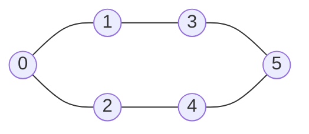

Its adjacency list is:

```text
0 -> [1, 2]
1 -> [0, 3]
2 -> [0, 4]
3 -> [1, 5]
4 -> [2, 5]
5 -> [3, 4]
```

Starting at vertex `0`, the code normally produces:

```text
BFS: [0, 1, 2, 3, 4, 5]
DFS: [0, 1, 3, 5, 4, 2]
```

The exact traversal order depends on the order in which neighbors are stored.

```kotlin
import java.util.ArrayDeque

class Graph(
    val size: Int,
    private val directed: Boolean = false
) {
    val adjacencyList: Array<MutableList<Int>> =
        Array(size) { mutableListOf() }

    fun addEdge(source: Int, destination: Int) {
        adjacencyList[source].add(destination)

        if (!directed) {
            adjacencyList[destination].add(source)
        }
    }

    fun bfs(start: Int): List<Int> {
        val visited = BooleanArray(size)
        val queue = ArrayDeque<Int>()
        val order = mutableListOf<Int>()

        visited[start] = true
        queue.addLast(start)

        while (queue.isNotEmpty()) {
            val vertex = queue.removeFirst()
            order.add(vertex)

            for (neighbor in adjacencyList[vertex]) {
                if (!visited[neighbor]) {
                    visited[neighbor] = true
                    queue.addLast(neighbor)
                }
            }
        }

        return order
    }

    fun dfs(start: Int): List<Int> {
        val visited = BooleanArray(size)
        val order = mutableListOf<Int>()

        fun visit(vertex: Int) {
            visited[vertex] = true
            order.add(vertex)

            for (neighbor in adjacencyList[vertex]) {
                if (!visited[neighbor]) {
                    visit(neighbor)
                }
            }
        }

        visit(start)
        return order
    }
}

fun main() {
    val graph = Graph(size = 6)

    graph.addEdge(0, 1)
    graph.addEdge(0, 2)
    graph.addEdge(1, 3)
    graph.addEdge(2, 4)
    graph.addEdge(3, 5)
    graph.addEdge(4, 5)

    println("BFS: ${graph.bfs(0)}")
    println("DFS: ${graph.dfs(0)}")
}
```

---

## Final Interview Takeaway

When solving a graph problem:

1. Identify whether the graph is directed, weighted, cyclic, and connected.
2. Select a representation that supports the required operations.
3. Use BFS for levels and minimum-edge paths.
4. Use DFS for deep exploration, cycles, components, and ordering.
5. Track visited vertices unless the graph structure guarantees that cycles and repeated paths are impossible.
6. State complexity in terms of both `V` and `E`.
7. Test disconnected graphs, isolated vertices, self-loops, duplicate edges, and empty input when permitted by the problem.
