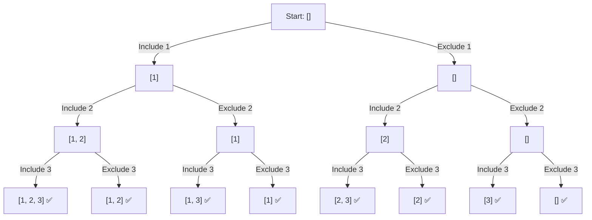

# LeetCode 78: Subsets

## Problem

Given an integer array `nums` containing unique elements, return every possible subset.

The result must include:

- The empty subset.
- Every single-element subset.
- Every combination of multiple elements.
- The subset containing all elements.

The subsets may be returned in any order.

### Example

```text
Input:
nums = [1, 2, 3]

Output:
[
  [1, 2, 3],
  [1, 2],
  [1, 3],
  [1],
  [2, 3],
  [2],
  [3],
  []
]
```

## Core Idea

For every number, make one of two decisions:

1. **Include** the current number in the subset.
2. **Exclude** the current number from the subset.

After making either decision, move to the next index.

```text
Include: add nums[index], then recurse with index + 1
Exclude: do not add nums[index], then recurse with index + 1
```

Because each of the `n` numbers has two choices, there are:

```text
2^n subsets
```

For three numbers:

```text
2^3 = 8 subsets
```

## Decision Tree

For:

```text
nums = [1, 2, 3]
```



Each leaf represents one completed subset.

## Kotlin Solution

```kotlin
class Solution {
    fun subsets(nums: IntArray): List<List<Int>> {
        val res = mutableListOf<List<Int>>()
        val subset = mutableListOf<Int>()

        fun backtracking(index: Int) {
            // We have made an include/exclude decision for every number.
            if (index >= nums.size) {
                // Add a copy because subset is mutable and will continue
                // changing as the recursion backtracks.
                res.add(subset.toList())
                return
            }

            // Choice 1: Include the current number.
            subset.add(nums[index])
            backtracking(index + 1)

            // Undo the inclusion before exploring the exclude choice.
            subset.removeLast()

            // Choice 2: Exclude the current number.
            backtracking(index + 1)
        }

        // Start making decisions from the first number.
        backtracking(0)

        return res
    }
}
```

If `removeLast()` is unavailable in the Kotlin version being used, write:

```kotlin
subset.removeAt(subset.lastIndex)
```

## How Backtracking Works

Suppose the current state is:

```text
subset = [1, 2]
index = 2
```

The algorithm first includes `nums[2]`, which is `3`:

```text
[1, 2] -> [1, 2, 3]
```

After saving `[1, 2, 3]`, it returns and removes the last choice:

```text
[1, 2, 3] -> [1, 2]
```

It can then explore the branch where `3` is excluded and save:

```text
[1, 2]
```

Removing the last choice restores the list to the state it had before that choice was made.

## Why Save `subset.toList()`?

`subset` is one mutable list shared by every recursive call. The algorithm repeatedly adds and removes elements from this same list.

```kotlin
res.add(subset.toList())
```

`toList()` creates a snapshot of the subset in its current state.

Without making a copy, saved results could refer to the same mutable list and change during later backtracking operations.

## Why Remove the Last Element?

After exploring the branch that includes the current number, the algorithm must undo that decision:

```kotlin
subset.removeLast()
```

This restores `subset` before the exclude branch is explored.

For example:

```text
Before inclusion:  [1]
After inclusion:   [1, 2]
After backtracking:[1]
```

This undo operation is the **backtrack** step.

## Why Both Calls Use `index + 1`

Each input number may be used at most once in a subset.

Therefore, after either including or excluding `nums[index]`, the algorithm moves to the next number:

```kotlin
backtracking(index + 1)
```

This is different from Combination Sum, where the include branch keeps the same index because a candidate may be reused.

```text
Subsets:
Include -> index + 1
Exclude -> index + 1

Combination Sum:
Include -> same index
Exclude -> index + 1
```

## Complexity Analysis

Let `n` be the number of elements in `nums`.

### Time Complexity

```text
O(n * 2^n)
```

Explanation:

- Every number has two choices: include or exclude.
- Therefore, the algorithm generates `2^n` subsets.
- Copying one subset with `toList()` can take up to `O(n)` time.

The total time is therefore:

```text
number of subsets * copying cost
= 2^n * n
= O(n * 2^n)
```

### Auxiliary Space

```text
O(n)
```

Explanation:

- The recursion stack can reach a depth of `n`.
- The current `subset` can contain at most `n` elements.

This excludes the returned output.

### Output Space

```text
O(n * 2^n)
```

There are `2^n` subsets, and each subset may contain up to `n` elements.

## Common Mistakes

### Forgetting to save a copy

```kotlin
// Correct: save a snapshot.
res.add(subset.toList())
```

The current subset is mutable and changes during backtracking.

### Forgetting to undo the include choice

```kotlin
subset.removeLast()
```

Without this line, elements from the include branch remain in the list while the exclude branch is explored.

### Removing from the wrong list

```kotlin
// Incorrect
subset.remove(nums.lastIndex)
```

`nums.lastIndex` is an index from the input array, while `remove()` removes an element by value.

Remove the last selected element instead:

```kotlin
subset.removeLast()
```

or:

```kotlin
subset.removeAt(subset.lastIndex)
```

### Saving a subset too early

In this version, a subset is saved only after every number has received an include/exclude decision:

```kotlin
if (index >= nums.size) {
    res.add(subset.toList())
    return
}
```

This ensures every leaf of the decision tree contributes exactly one result.

## Backtracking Template

```text
backtracking(index):
    if index is past the final number:
        save a copy of the current subset
        return

    include nums[index]
    backtracking(index + 1)

    undo the inclusion

    exclude nums[index]
    backtracking(index + 1)
```

## Key Takeaway

```text
For every number:
1. Include it.
2. Backtrack.
3. Exclude it.
```

The include/exclude decision creates a binary tree with `2^n` leaves, where every leaf is one subset.
