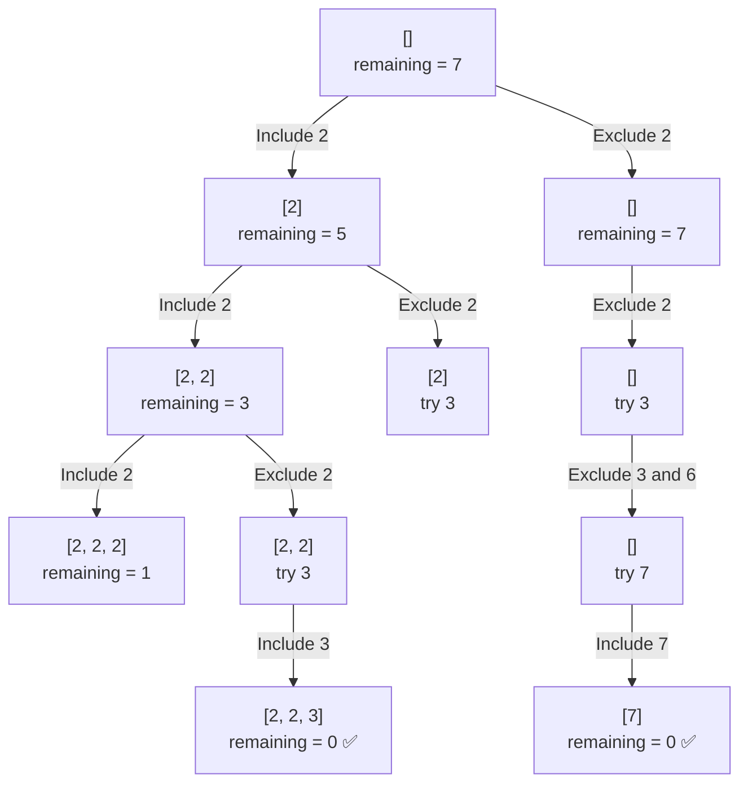

# LeetCode 39: Combination Sum

## Problem

Given an array of **distinct positive integers** called `candidates` and an integer `target`, return all unique combinations whose sum equals `target`.

The same candidate may be selected an unlimited number of times.

### Example

```text
Input:
candidates = [2, 3, 6, 7]
target = 7

Output:
[
  [2, 2, 3],
  [7]
]
```

## Core Idea

At every index, make one of two decisions:

1. **Include** `candidates[index]`.
    - Subtract its value from the remaining target.
    - Keep the same index because the candidate can be reused.
2. **Exclude** `candidates[index]`.
    - Move to the next index.

This is different from the Subsets problem because an included candidate can be selected again.

```text
Include: backtrack(index, remaining - candidates[index])
Exclude: backtrack(index + 1, remaining)
```

## Decision Tree

For:

```text
candidates = [2, 3, 6, 7]
target = 7
```



Branches stop when:

- `remaining == 0`: a valid combination was found.
- `remaining < 0`: the combination exceeded the target.
- `index == candidates.size`: there are no candidates left to try.

## Kotlin Solution

```kotlin
class Solution {
    fun combinationSum(
        candidates: IntArray,
        target: Int
    ): List<List<Int>> {
        val result = mutableListOf<List<Int>>()
        val combination = mutableListOf<Int>()

        fun backtrack(index: Int, remaining: Int) {
            // A remaining value of zero means the current combination
            // adds up exactly to the original target.
            if (remaining == 0) {
                // Save a copy because combination is mutable and will
                // continue changing while backtracking.
                result.add(combination.toList())
                return
            }

            // Stop when the sum exceeds the target or when there are
            // no more candidates available.
            if (remaining < 0 || index >= candidates.size) {
                return
            }

            // Choice 1: Include the current candidate.
            combination.add(candidates[index])

            // Keep the same index because each candidate may be reused.
            backtrack(index, remaining - candidates[index])

            // Undo the inclusion before exploring the exclude choice.
            combination.removeAt(combination.lastIndex)

            // Choice 2: Exclude the current candidate and move forward.
            backtrack(index + 1, remaining)
        }

        backtrack(index = 0, remaining = target)
        return result
    }
}
```

## Why Save `combination.toList()`?

`combination` is one mutable list shared by all recursive calls. Backtracking repeatedly adds and removes values from it.

If the mutable list itself were added to the result, later changes could also affect combinations that had already been saved.

```kotlin
result.add(combination.toList())
```

`toList()` creates a snapshot of the current combination.

## Why Reuse the Same Index?

After including a candidate, the recursive call uses the same index:

```kotlin
backtrack(index, remaining - candidates[index])
```

This allows combinations such as:

```text
[2, 2, 3]
```

If the call used `index + 1`, each candidate could only be selected once.

## Why This Avoids Duplicate Combinations

The algorithm processes candidates in index order. After excluding a candidate, it never returns to an earlier index.

For example, it may generate:

```text
[2, 2, 3]
```

but it will not later generate different orderings such as:

```text
[2, 3, 2]
[3, 2, 2]
```

All three contain the same values, so only the index-ordered version is explored.

## Complexity Analysis

Let:

- `n` be the number of candidates.
- `T` be the target.
- `m` be the smallest candidate.

```text
Maximum recursion depth = T / m
```

### Time Complexity

```text
O(2^(T / m))
```

At each recursive state, the algorithm can include or exclude a candidate. The maximum number of inclusions along one path is approximately `T / m`.

Copying valid combinations also contributes to the total running time, so the exact cost depends on the number and length of the returned combinations.

### Auxiliary Space

```text
O(T / m)
```

The recursion stack and current combination can both reach a maximum depth of approximately `T / m`.

This excludes the space required for the returned combinations.

## Common Mistakes

### Moving to the next index after inclusion

```kotlin
// Incorrect for this problem
backtrack(index + 1, remaining - candidates[index])
```

This prevents the current candidate from being reused.

### Forgetting to undo the choice

```kotlin
combination.removeAt(combination.lastIndex)
```

Without this step, values selected in one branch leak into other branches.

### Removing by value instead of position

```kotlin
// Remove the last selected element by its index.
combination.removeAt(combination.lastIndex)
```

Using `remove(value)` can remove the wrong occurrence when a candidate appears multiple times in the current combination.

### Saving the mutable list directly

```kotlin
// Save a snapshot, not the shared mutable list.
result.add(combination.toList())
```

## Backtracking Template

```text
backtrack(index, remaining):
    if remaining == 0:
        save a copy of the current combination
        return

    if remaining < 0 or index is out of bounds:
        return

    include candidates[index]
    backtrack(index, remaining - candidates[index])
    undo the inclusion

    exclude candidates[index]
    backtrack(index + 1, remaining)
```

## Key Takeaway

```text
Include -> stay at the same index
Exclude -> move to the next index
```

Staying at the same index after inclusion is what allows unlimited reuse of each candidate.
