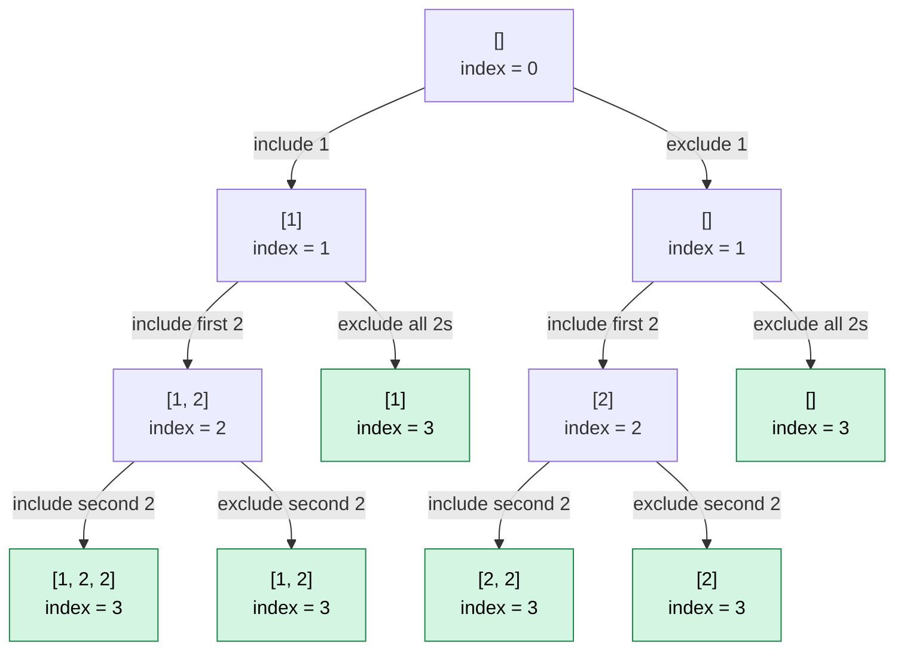

# 90. Subsets II

## Problem

Given an integer array `nums` that may contain duplicates, return all possible subsets.

The solution set must not contain duplicate subsets. You can return the answer in **any order**.

Problem: [LeetCode 90 - Subsets II](https://leetcode.com/problems/subsets-ii/)

## Main Difference from Subsets I

| Subsets I | Subsets II |
|---|---|
| Input values are distinct | Input may contain duplicates |
| Every include/exclude path is unique | Different paths may produce the same subset |
| Sorting is unnecessary | Sorting groups duplicates together |
| No duplicate skipping | Skip duplicates on the exclude branch |

## Approach: Include or Exclude

At every index, make one of two decisions:

1. **Include** the current number and move to the next index.
2. **Exclude** the current number and move past every duplicate of that value.

The array must first be sorted so duplicate values are adjacent.

## Kotlin Solution

```kotlin
class Solution {
    fun subsetsWithDup(nums: IntArray): List<List<Int>> {
        val result = mutableListOf<List<Int>>()
        val currentSubset = mutableListOf<Int>()

        // Sorting places duplicate values next to each other.
        nums.sort()

        fun dfs(index: Int) {
            // All numbers have been considered.
            if (index == nums.size) {
                // Save a copy because currentSubset is modified
                // while backtracking.
                result.add(currentSubset.toList())
                return
            }

            // Include the current number.
            currentSubset.add(nums[index])
            dfs(index + 1)

            // Undo the inclusion before exploring the exclude branch.
            currentSubset.removeLast()

            // Skip every duplicate of the current value when excluding it.
            // This prevents identical subsets from being generated by
            // choosing different copies of the same value.
            var nextIndex = index + 1

            while (
                nextIndex < nums.size &&
                nums[nextIndex] == nums[index]
            ) {
                nextIndex++
            }

            // Exclude the current value and continue from the first
            // different value.
            dfs(nextIndex)
        }

        dfs(index = 0)
        return result
    }
}
```

## Why Sorting Is Necessary

Sorting places equal values beside each other:

```text
Before sorting: [2, 1, 2]
After sorting:  [1, 2, 2]
```

The duplicate-skipping loop can then move over every adjacent copy of the current value:

```kotlin
while (
    nextIndex < nums.size &&
    nums[nextIndex] == nums[index]
) {
    nextIndex++
}
```

Without sorting, duplicate values may be separated and cannot be skipped reliably with this loop.

## Why Duplicates Are Skipped on the Exclude Branch

Consider:

```text
nums = [1, 2, 2]
```

If the first `2` is excluded but recursion immediately continues at the second `2`, the subset `[2]` can be generated in two ways:

```text
Include the first 2 and exclude the second 2 -> [2]
Exclude the first 2 and include the second 2 -> [2]
```

To prevent this duplication, the exclude branch skips every remaining copy of the current value:

```kotlin
var nextIndex = index + 1

while (
    nextIndex < nums.size &&
    nums[nextIndex] == nums[index]
) {
    nextIndex++
}

dfs(nextIndex)
```

The include branch moves only one position:

```kotlin
dfs(index + 1)
```

This is important because it still allows valid subsets containing repeated values, such as `[2, 2]`.

## Decision Tree

Consider:

```text
nums = [1, 2, 2]
```

Each node shows the current subset:



The unique subsets are:

```text
[]
[1]
[2]
[1, 2]
[2, 2]
[1, 2, 2]
```

When excluding the first `2`, recursion skips the second `2`:

```text
index = 1
nextIndex = 2

nums[2] == nums[1] // both are 2
nextIndex = 3
```

The exclude branch therefore jumps directly from index `1` to index `3`.

## Backtracking

The include branch changes `currentSubset`:

```kotlin
currentSubset.add(nums[index])
dfs(index + 1)
```

After recursion returns, that choice must be reversed:

```kotlin
currentSubset.removeLast()
```

This restores the previous subset before the exclude branch is explored.

For example:

```text
Start:            []
Include 1:        [1]
Include first 2:  [1, 2]
Include second 2: [1, 2, 2]
Remove second 2:  [1, 2]
Remove first 2:   [1]
Exclude all 2s:   [1]
```

## Why `toList()` Is Necessary

```kotlin
result.add(currentSubset.toList())
```

`currentSubset` is one mutable list shared by every recursive call. `toList()` creates a snapshot of its elements when a subset is completed.

Later calls to `add()` and `removeLast()` therefore do not change subsets already stored in `result`.

## Why the Base Case Adds the Subset

```kotlin
if (index == nums.size) {
    result.add(currentSubset.toList())
    return
}
```

A subset is complete when every input position has been either included or excluded.

This also adds the empty subset:

```text
[]
```

The empty subset is produced by following the exclude branch for every value.

## Example

```text
Input:
nums = [1, 2, 2]

Output:
[
  [],
  [1],
  [2],
  [1, 2],
  [2, 2],
  [1, 2, 2]
]
```

The output may appear in a different order.

## Complexity

```text
Time:  O(N * 2^N) in the worst case
Space: O(N), excluding the returned subsets
```

- There can be up to `2^N` unique subsets.
- Copying a subset into the result can take up to `O(N)`.
- Sorting takes `O(N log N)`, which is dominated by subset generation.
- The recursion depth is at most `N`.
- `currentSubset` can contain at most `N` elements.

If the returned result is included in the space analysis, it can require:

```text
O(N * 2^N)
```

## Key Points

- Sort the input so duplicate values are adjacent.
- Include the current number with `dfs(index + 1)`.
- Backtrack with `removeLast()` after the include branch.
- On the exclude branch, skip all adjacent duplicates.
- Skip duplicates only on exclusion so repeated values can still appear in a subset.
- Use `toList()` when saving a completed subset.
- Add a subset when every input position has been considered.
