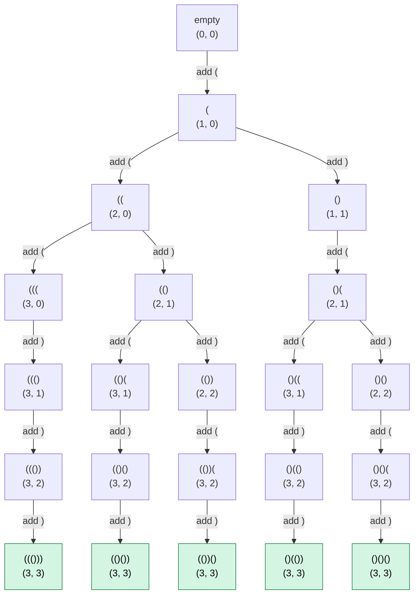

# 22. Generate Parentheses

## Problem

Given `n` pairs of parentheses, write a function to generate all combinations of well-formed parentheses.

Problem: [LeetCode 22 - Generate Parentheses](https://leetcode.com/problems/generate-parentheses/)

## Approach: Backtracking with Validity Rules

Build each string one character at a time while tracking:

- `openCount`: the number of opening parentheses used.
- `closeCount`: the number of closing parentheses used.

At every recursive call, there are at most two choices:

1. Add `(` if fewer than `n` opening parentheses have been used.
2. Add `)` if there is an unmatched opening parenthesis.

These two rules prevent invalid strings from being generated.

## Kotlin Solution

```kotlin
class Solution {
    fun generateParenthesis(n: Int): List<String> {
        val result = mutableListOf<String>()
        val current = StringBuilder()

        fun dfs(openCount: Int, closeCount: Int) {
            // A valid result contains n opening and n closing parentheses.
            if (openCount == n && closeCount == n) {
                result.add(current.toString())
                return
            }

            // Add an opening parenthesis while fewer than n have been used.
            if (openCount < n) {
                current.append('(')

                dfs(openCount + 1, closeCount)

                // Undo the choice before exploring another branch.
                current.deleteCharAt(current.lastIndex)
            }

            // Add a closing parenthesis only when an unmatched opening
            // parenthesis is available.
            if (closeCount < openCount) {
                current.append(')')

                dfs(openCount, closeCount + 1)

                // Undo the choice before returning to the previous call.
                current.deleteCharAt(current.lastIndex)
            }
        }

        dfs(openCount = 0, closeCount = 0)
        return result
    }
}
```

## Rule 1: When Can We Add `(`?

```kotlin
if (openCount < n)
```

Only `n` opening parentheses are available. Once `openCount` reaches `n`, no more opening parentheses can be added.

For `n = 3`:

```text
"(((" is allowed.
"((((" is not allowed.
```

## Rule 2: When Can We Add `)`?

```kotlin
if (closeCount < openCount)
```

A closing parenthesis can be added only when an unmatched opening parenthesis already exists.

For example:

```text
"("  -> ")" can be added.
"()" -> ")" cannot be added because both parentheses are matched.
```

This rule prevents invalid prefixes such as:

```text
")"
"())"
"())("
```

Another way to express the same rule is:

```text
At every point:

closeCount <= openCount
```

## Base Case

```kotlin
if (openCount == n && closeCount == n) {
    result.add(current.toString())
    return
}
```

A completed result contains exactly:

```text
n opening parentheses
n closing parentheses
2 * n total characters
```

Because invalid choices are prevented during recursion, every string reaching the base case is well formed.

## Decision Tree

Consider:

```text
n = 3
```

Each node shows:

```text
current string (openCount, closeCount)
```



The five valid results are:

```text
((()))
(()())
(())()
()(())
()()()
```

The tree does not contain a branch beginning with `)` because:

```text
closeCount = openCount = 0
```

Therefore:

```kotlin
closeCount < openCount
```

is false at the root.

## Backtracking

When a parenthesis is chosen, it is appended to `current`:

```kotlin
current.append('(')
dfs(openCount + 1, closeCount)
```

After recursion returns, that choice must be removed:

```kotlin
current.deleteCharAt(current.lastIndex)
```

The same process is used for `)`:

```kotlin
current.append(')')
dfs(openCount, closeCount + 1)
current.deleteCharAt(current.lastIndex)
```

For example:

```text
Start:          ""
Add (:          "("
Add (:          "(("
Add ):          "(()"
Explore branch: ...
Remove ):       "(("
Try next choice: ...
```

Backtracking restores the previous string so another valid choice can be explored.

## Why Use `StringBuilder`?

Strings are immutable in Kotlin. Repeated string concatenation creates new string objects.

`StringBuilder` allows the algorithm to:

```kotlin
current.append('(')
current.deleteCharAt(current.lastIndex)
```

This efficiently adds and removes the last character during backtracking.

When a valid result is found:

```kotlin
result.add(current.toString())
```

`toString()` creates the completed immutable string stored in `result`.

## Why Invalid Combinations Are Not Generated

A brute-force solution could generate every string of length `2 * n` and then validate each one.

This backtracking solution prunes invalid choices immediately:

```kotlin
if (openCount < n)
```

prevents using too many opening parentheses, and:

```kotlin
if (closeCount < openCount)
```

prevents using a closing parenthesis without a matching opening parenthesis.

Therefore, recursion explores only prefixes that can still become valid results.

## Example

```text
Input:
n = 3

Output:
[
  "((()))",
  "(()())",
  "(())()",
  "()(())",
  "()()()"
]
```

The output may appear in a different order.

## Complexity

```text
Time:  O(Cn * N)
Space: O(N), excluding the returned strings
```

`Cn` is the `n`th Catalan number:

```text
Cn = (1 / (N + 1)) * (2N choose N)
```

- There are `Cn` valid combinations of `n` pairs of parentheses.
- Each completed string has `2N` characters.
- Converting `StringBuilder` to a string takes `O(N)`.
- The recursion depth is at most `2N`, which is `O(N)`.
- `current` contains at most `2N` characters.

If the returned result is included in the space analysis, it requires:

```text
O(Cn * N)
```

## Key Points

- Add `(` only when `openCount < n`.
- Add `)` only when `closeCount < openCount`.
- A completed result has `n` opening and `n` closing parentheses.
- Use `StringBuilder` for efficient backtracking.
- Remove the last character after every recursive call.
- Invalid prefixes are pruned before they are generated.
- The number of valid results follows the Catalan numbers.
